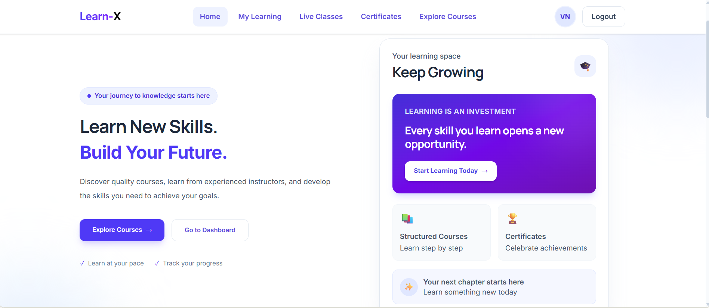
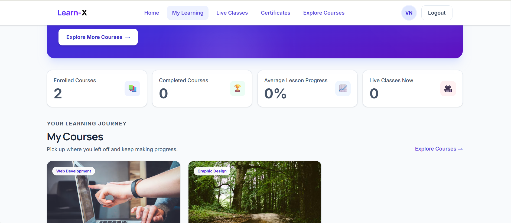
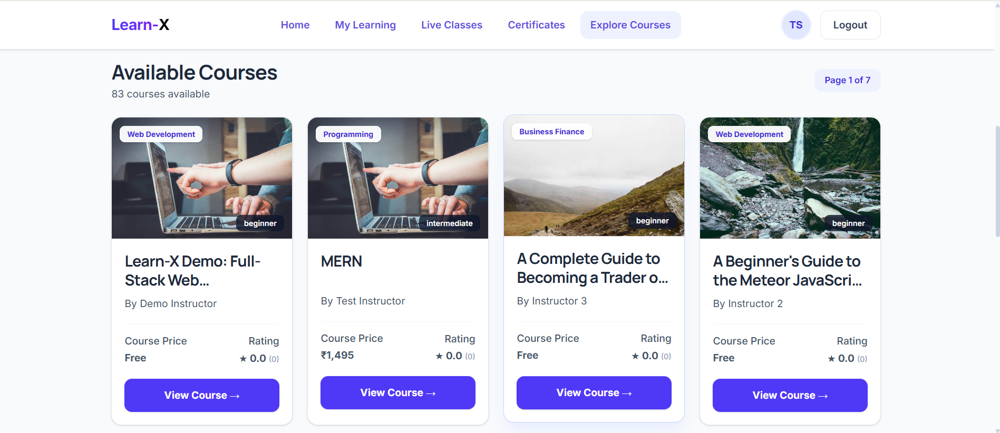
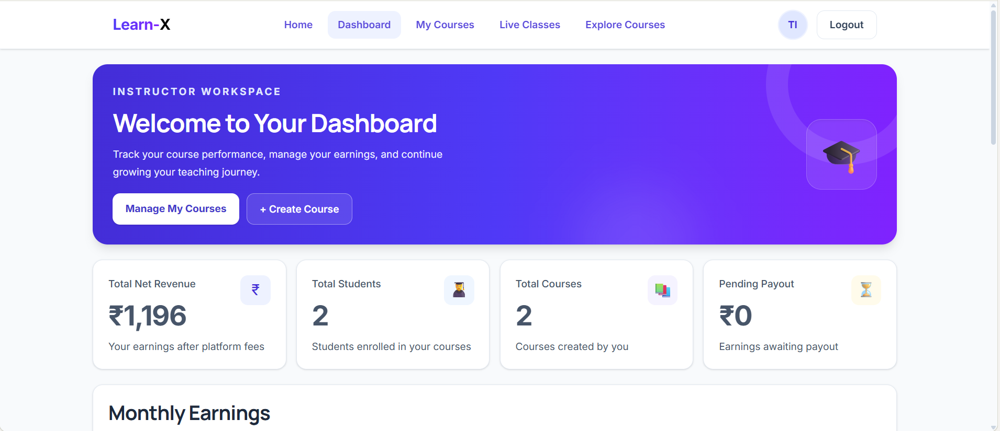
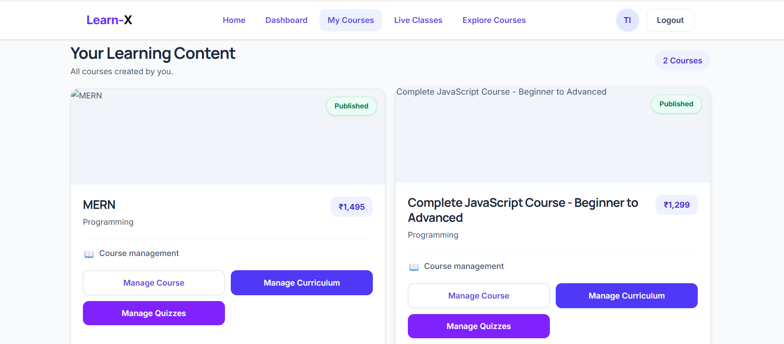
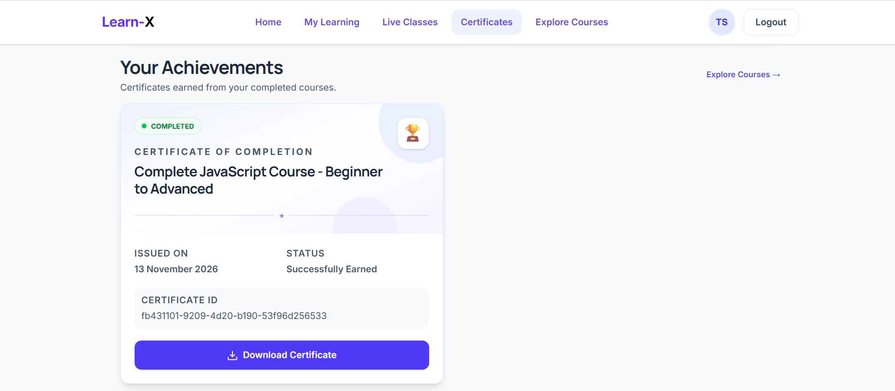
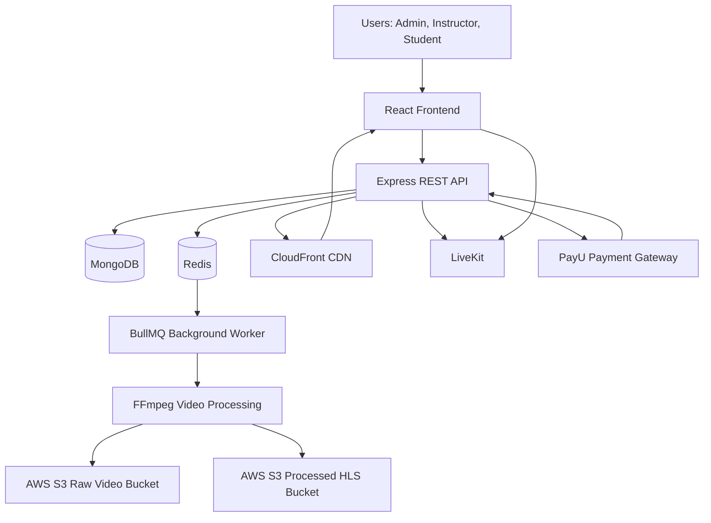
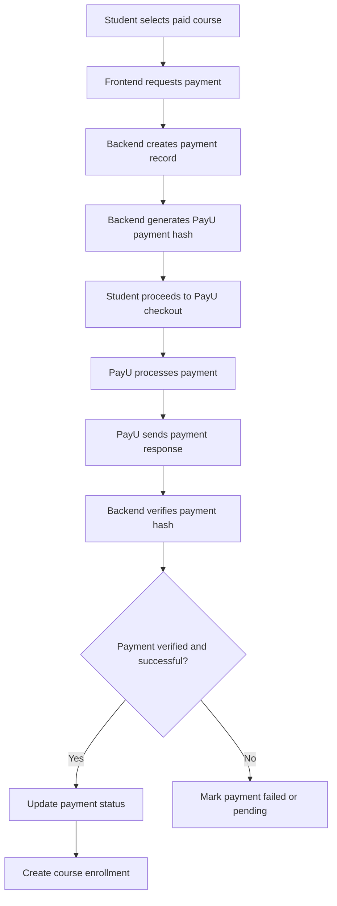

# Learn-X – Full-Stack Learning Management System

Learn-X is a full-stack Learning Management System (LMS) built using the MERN stack. It provides a platform for students to learn through structured courses, video lessons, quizzes, progress tracking, and live classes.

The platform supports three roles:

- **Admin:** Manages users and platform operations.
- **Instructor:** Creates and manages courses, lessons, quizzes, and live classes.
- **Student:** Enrolls in courses, watches lessons, attempts quizzes, and tracks learning progress.

## 1. Project Information

| Detail | Description |
|---|---|
| Project | Learn-X |
| Type | Full-Stack Learning Management System |
| Frontend | React, Vite, Tailwind CSS |
| Backend | Node.js, Express.js |
| Database | MongoDB with Mongoose |
| Cache and Queue | Redis, BullMQ |
| Video Processing | FFmpeg |
| Video Storage | AWS S3 |
| Video Delivery | AWS CloudFront |
| Live Classes | LiveKit |
| Payment Gateway | PayU |
| Containerization | Docker, Docker Compose |
| Testing | Vitest, Supertest |

### Local Application URLs

| Application | URL |
|---|---|
| Frontend | http://localhost:5173 |
| Backend API | http://localhost:5000 |
| API base path | http://localhost:5000/api |

**Deployment status:** The project is currently configured for local execution. Public production URLs are not available.

## 2. Application Screenshots

### Student Dashboard



### Course Learning Interface



### Course Catalog



### Instructor Dashboard



### Instructor Course Management



### Certificate



## 3. Technology Stack

| Layer | Technologies |
|---|---|
| Frontend | React, Vite, Tailwind CSS |
| State Management | Redux Toolkit |
| Routing | React Router |
| Backend | Node.js, Express.js |
| Database | MongoDB, Mongoose |
| Authentication | JWT, bcrypt |
| Background Jobs | Redis, BullMQ |
| Video Processing | FFmpeg |
| Video Storage | AWS S3 |
| Video Delivery | AWS CloudFront |
| Live Streaming | LiveKit |
| Payments | PayU |
| Containerization | Docker, Docker Compose |
| Testing | Vitest, Supertest, MongoDB Memory Server |

## 4. System Architecture



### Architecture Explanation

1. Users interact with the React frontend.
2. The frontend communicates with the Express backend through REST APIs.
3. MongoDB stores users, courses, sections, lessons, enrollments, quizzes, and related records.
4. Redis and BullMQ handle background processing jobs.
5. FFmpeg processes uploaded videos into HLS format.
6. AWS S3 stores raw and processed video files.
7. CloudFront delivers protected video content.
8. LiveKit provides real-time live-class functionality.
9. PayU handles payment processing for paid courses.

## 5. Video Processing Pipeline

Learn-X uses asynchronous video processing so that uploading a video does not require the API server to process the entire video synchronously.

### Video Workflow

1. An instructor uploads a lesson video.
2. The backend validates the upload and stores the original video in the raw S3 bucket.
3. A processing job is added to the BullMQ queue.
4. The worker retrieves the processing job.
5. FFmpeg converts the original video into HLS format.
6. The processed HLS files are uploaded to the processed S3 bucket.
7. The lesson's processing status is updated to `ready`.
8. Students can request playback through the protected lesson endpoint.
9. CloudFront delivers the HLS content.

### Lesson Processing States

| Status | Description |
|---|---|
| `none` | No video uploaded |
| `uploaded` | Original video uploaded |
| `processing` | Video processing is running |
| `ready` | Processing completed |
| `failed` | Processing failed |

### HLS Structure

```text
lessons/
  <lessonId>/
    master.m3u8
    segment files
```

The expected master playlist path is:

```text
lessons/<lessonId>/master.m3u8
```

## 6. PayU Payment Flow

Learn-X uses PayU as its payment gateway for paid-course transactions.

### Payment Workflow



### Payment Explanation

1. A student selects a paid course.
2. The frontend requests payment initiation from the backend.
3. The backend creates a payment record.
4. The backend generates the required PayU payment hash.
5. The student is redirected to the PayU checkout flow.
6. PayU processes the payment.
7. PayU returns the transaction response.
8. The backend verifies the response hash and payment details.
9. After successful verification, the payment status is updated.
10. Course enrollment is fulfilled after successful payment verification.

**Payment security:** The backend must verify payment responses and webhook notifications. Enrollment must never be granted simply because the frontend reports a successful payment.

### PayU Configuration

Configure the following variables in `server/.env`:

| Variable | Purpose |
|---|---|
| `PAYU_KEY` | PayU merchant key |
| `PAYU_SALT` | PayU merchant salt |
| `PAYU_BASE_URL` | PayU payment gateway endpoint |
| `PAYU_WEBHOOK_SECRET` | Webhook verification configuration |

Use PayU test credentials for development and testing. Never expose the merchant salt or other secret values in frontend code or GitHub.

Official documentation: https://docs.payu.in/

## 7. Authentication and Access Control

Learn-X uses JWT-based authentication.

- Passwords are hashed using bcrypt.
- Access tokens authenticate protected API requests.
- Refresh tokens are stored in HTTP-only cookies.
- User roles determine access to protected resources.

### Role-Based Permissions

| Feature | Admin | Instructor | Student |
|---|---|---|---|
| Manage platform users | Yes | No | No |
| Create courses | Yes | Yes | No |
| Manage courses | Yes | Own courses | No |
| Upload lessons | Yes | Own courses | No |
| Watch lessons | Yes | Yes | Enrolled / preview |
| Attempt quizzes | Administrative access | Course management | Yes |
| Track learning progress | Administrative access | Course management | Own progress |
| Join live classes | Administrative access | Host | Participant |

### Protected Video Stream Endpoint

The student playback endpoint is:

```http
GET /api/student/lessons/:id/playback
```

Before generating playback access, the backend checks:

1. Whether the lesson ID is valid.
2. Whether the lesson exists.
3. Whether its course is published.
4. Whether the user is an instructor, administrator, enrolled student, or has preview access.
5. Whether the lesson processing status is `ready`.
6. Whether the stored HLS path matches the expected lesson path.

### Enrollment Guard

A student cannot access a private course lesson simply by knowing its lesson ID.

The backend checks the enrollment record associated with the authenticated user and course.

Preview lessons are permitted without enrollment.

### Signed CloudFront URLs

After authorization, the backend generates signed CloudFront access for the lesson folder.

This prevents unrestricted access to protected video resources through ordinary public URLs.

### LiveKit Token Grants

LiveKit access tokens are generated by the backend.

The backend should validate the user's identity, class permissions, and role before granting room access.

Instructor tokens should receive the permissions needed to publish media, while student tokens should receive participant-level permissions.

## 8. Installation and Setup

### Prerequisites

Install the following:

- Node.js
- npm
- Git
- Docker Desktop
- Docker Compose

### Option A: Run with Docker

Clone the repository:

```bash
git clone https://github.com/venkatNagamalla/learn-x.git

cd learn-x
```

Create the server environment file:

```bash
cp server/.env.example server/.env
```

Update the environment variables with your local configuration.

Start the application:

```bash
docker compose up --build
```

This starts the application services:

- React frontend
- Express API
- MongoDB
- Redis
- Background worker

Open the application:

```text
http://localhost:5173
```

### Seed Demo Data

In another terminal, run:

```bash
docker compose run --rm --build api node src/scripts/seedDemo.js
```

This creates or updates the demo accounts, course, sections, lessons, quiz, and student enrollment.

### Option B: Run Without Docker

Start MongoDB and Redis separately and make sure they are accessible.

Configure the local environment variables in `server/.env`.

Install backend dependencies:

```bash
cd server

npm install
```

Install frontend dependencies:

```bash
cd ../client

npm install
```

Start the backend API:

```bash
cd server

npm run dev
```

Start the background worker in another terminal:

```bash
cd server

npm run worker
```

Start the frontend in another terminal:

```bash
cd client

npm run dev
```

The frontend runs at:

```text
http://localhost:5173
```

The backend runs at:

```text
http://localhost:5000
```

### Demo Data Command

Alternatively, if the seed script is configured in `server/package.json`, run:

```bash
cd server

npm run seed:demo
```

For local execution, the `MONGO_URI` in `server/.env` must point to the correct MongoDB instance and use valid credentials.

When running the seed inside Docker Compose, the API container uses the Docker service hostname `mongo`.

## 9. Environment Variables

Create `server/.env` using `server/.env.example`.

Never commit real secrets, private keys, or production credentials.

| Variable | Purpose |
|---|---|
| `NODE_ENV` | Application environment |
| `PORT` | Backend server port |
| `CLIENT_URL` | Frontend URL |
| `SERVER_URL` | Backend URL |
| `MONGO_URI` | MongoDB connection string |
| `REDIS_URL` | Redis connection string |
| `JWT_ACCESS_SECRET` | Access token signing secret |
| `JWT_REFRESH_SECRET` | Refresh token signing secret |
| `AWS_REGION` | AWS region |
| `AWS_ACCESS_KEY_ID` | AWS access key |
| `AWS_SECRET_ACCESS_KEY` | AWS secret key |
| `AWS_S3_RAW_BUCKET` | Raw video bucket |
| `AWS_S3_PROCESSED_BUCKET` | Processed video bucket |
| `CLOUDFRONT_DOMAIN` | CloudFront distribution domain |
| `CLOUDFRONT_KEY_PAIR_ID` | CloudFront signing key ID |
| `CLOUDFRONT_PRIVATE_KEY_PATH` | CloudFront private key path |
| `PAYU_KEY` | PayU merchant key |
| `PAYU_SALT` | PayU merchant salt |
| `PAYU_BASE_URL` | PayU payment gateway endpoint |
| `PAYU_WEBHOOK_SECRET` | PayU webhook verification configuration |
| `PLATFORM_FEE_PERCENT` | Platform fee percentage |
| `LIVEKIT_URL` | LiveKit server URL |
| `LIVEKIT_API_KEY` | LiveKit API key |
| `LIVEKIT_API_SECRET` | LiveKit API secret |

Only configure external integrations that you intend to use. Keep all credentials private.

## 10. User Roles

| Role | Description |
|---|---|
| Admin | Controls platform-level operations and user management |
| Instructor | Creates and manages courses, lessons, quizzes, and live sessions |
| Student | Enrolls in courses and accesses learning resources |

The admin account is created through the demo seed or the dedicated admin creation script. Public registration does not allow users to register themselves as administrators.

## 11. API Overview

The backend exposes REST APIs under:

```text
/api
```

The following table summarizes the main API areas.

| API Area | Purpose |
|---|---|
| Authentication | Registration, login, token refresh, logout, current user |
| Courses | Course discovery and course management |
| Sections | Course curriculum and section management |
| Lessons | Lesson creation and lesson management |
| Student Learning | Enrolled course access and lesson playback |
| Enrollment | Course enrollment and access |
| Quizzes | Quiz creation, retrieval, and submission |
| Quiz Attempts | Student quiz attempt records |
| Progress | Lesson and quiz progress tracking |
| Payments | PayU payment creation and verification |
| Live Classes | Live session management |
| Certificates | Certificate generation and verification |
| Admin | Platform administration |
| Notifications | User notifications |

### Important Student Playback API

```http
GET /api/student/lessons/:id/playback
```

Requires authentication and lesson access authorization.

**Note:** Consult the corresponding files in `server/src/routes/` for the exact route paths, HTTP methods, and request parameters for each API group.

## 12. Progress Tracking

Learn-X maintains lesson progress and quiz progress separately.

- **Lesson progress:** Calculated from completed lessons.
- **Quiz progress:** Based on passed quizzes.
- **Quiz attempts:** Stored separately for each attempt.

Passing a quiz does not automatically increase lesson completion percentage.

Certificate eligibility can consider both lesson completion and required quiz results.

## 13. Demo Login Credentials

The local demo seed creates the following accounts:

| Role | Email | Password |
|---|---|---|
| Admin | `admin@lms.com` | `Demo@12345` |
| Instructor | `instructor@lms.com` | `Demo@12345` |
| Student | `student@lms.com` | `Demo@12345` |

**Important:** These are demonstration credentials only. Never use them in a production environment.

The demo seed creates one published course, two sections, two lessons, one quiz, and one student enrollment.

The lesson records are marked `ready`, but their HLS paths are placeholders until real video files are uploaded and processed.

## 14. PayU Test Payments

PayU test mode should be used for payment development.

Before testing:

1. Configure PayU test merchant credentials in `server/.env`.
2. Configure the PayU test endpoint.
3. Configure webhook verification settings if webhooks are enabled.
4. Verify that payment hashes are checked by the backend.
5. Confirm that enrollment is granted only after successful payment verification.

Use the test payment credentials and transaction details published in the official PayU documentation:

https://docs.payu.in/

Do not use real card details or real merchant credentials in development.

## 15. Testing

Learn-X uses Vitest and Supertest for backend testing.

Run the backend tests:

```bash
cd server

npm test
```

The latest verified local test run completed with:

- 4 test files
- 41 tests passed

The GitHub Actions workflow also runs server, client, and Docker image checks.

Testing should cover:

- Authentication and authorization
- Course access restrictions
- Enrollment checks
- Lesson playback access
- Quiz submission and attempts
- Progress tracking
- PayU payment verification
- API error handling

## 16. Trade-offs and Design Decisions

### MERN Stack

MongoDB and Express were selected to support flexible course, curriculum, and user data structures while keeping the backend JavaScript-based.

### Separate Background Worker

Video processing is resource-intensive. BullMQ and Redis allow the API to remain responsive while a separate worker handles processing tasks.

### HLS Video Delivery

HLS allows video content to be delivered in segments and supports adaptive streaming workflows.

### S3 and CloudFront

S3 provides object storage for raw and processed videos, while CloudFront provides content delivery with signed access.

### PayU Payment Gateway

PayU is used as the payment gateway for paid-course transactions. Payment verification is handled on the backend to prevent unauthorized enrollment.

### JWT Authentication

JWT access tokens and refresh-token cookies provide an authentication mechanism for protected frontend and backend operations.

### Separate Progress Metrics

Lesson progress and quiz progress are tracked independently to avoid misleading completion percentages.

### Docker

Docker Compose provides a repeatable local development environment for the API, frontend, MongoDB, and Redis.

### Deployment

The project is currently maintained as a local Docker-based application. Public hosting and production infrastructure are outside the current implementation scope.

## 17. Known Limitations

- The seeded demo lesson HLS files are placeholders and require actual uploaded videos for playback.
- Public production deployment URLs are not available.
- External AWS and LiveKit integrations require valid service credentials.
- PayU test checkout and payment verification should be validated using the configured test merchant account before being presented as production-ready.
- Production security, monitoring, backups, and infrastructure configuration require additional validation.

## 18. Repository Structure

```text
learn-x/
│
├── client/
│   ├── src/
│   ├── public/
│   └── package.json
│
├── server/
│   ├── src/
│   │   ├── config/
│   │   ├── controllers/
│   │   ├── middleware/
│   │   ├── models/
│   │   ├── routes/
│   │   ├── scripts/
│   │   ├── services/
│   │   ├── utils/
│   │   └── worker.js
│   ├── .env.example
│   └── package.json
│
├── docs/
│   └── screenshots/
│       ├── certificate.png
│       ├── courses.png
│       ├── instructor-courses.png
│       ├── instructor-dashboard.png
│       ├── student-dashboard.png
│       └── student-learning.png
│
├── .github/
│   └── workflows/
│
├── docker-compose.yml
└── README.md
```

## 19. Author

**Learn-X – Full-Stack Learning Management System**

Built using the MERN stack with background video processing, protected video delivery, role-based access control, PayU payment integration, quizzes, progress tracking, and live-class integration.

**GitHub Repository:**

https://github.com/venkatNagamalla/learn-x
